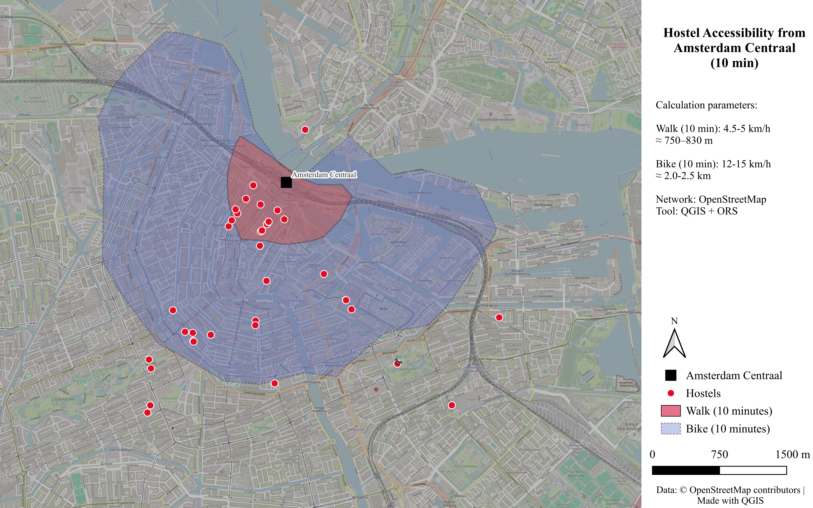

# Hostel Accessibility from Amsterdam Centraal: 10 Minutes on Foot and by Bike

A QGIS project that shows how many hostels in Amsterdam a traveler can reach from Amsterdam Centraal Station within 10 minutes on foot and within 10 minutes by bike, and where the gaps are.

## Why this project

Amsterdam Centraal is a major arrival point for visitors who come by train or from Schiphol Airport. A budget traveler choosing a hostel often asks a simple question: "How far is it from the station, and do I need public transport?" This project answers that question with a map and simple numbers.

## Research questions

1. How many hostels are within a 10-minute walk of Amsterdam Centraal?
2. How much does the choice grow if the traveler uses a bike for 10 minutes?
3. Where are hostels concentrated, and which parts of the city are poorly covered?

## Data

| Data | Source | Notes |
|------|--------|-------|
| Hostel locations | OpenStreetMap, tag `tourism=hostel` | Downloaded with QuickOSM |
| Street and path network | OpenStreetMap | Used for routing the isochrones |
| Origin point | Amsterdam Centraal Station | Point placed near the main station entrance |
| Basemap | OpenStreetMap Standard | Slightly desaturated for better readability of isochrones |

## Methods

1. **Hostel points.** Extracted hostels in the Amsterdam area from OpenStreetMap using the `tourism=hostel` tag.
2. **Isochrones.** Created 10-minute travel-time zones from Amsterdam Centraal for two modes:
   - Walking: 4.5–5 km/h (≈ 750–830 m)
   - Cycling: 12–15 km/h (≈ 2.0–2.5 km)  
   Routing performed with OpenRouteService (ORS) tools in QGIS.
3. **Cartography.** Final map composed in the QGIS Print Layout and exported as high-resolution PNG and PDF.

## Key observations

- A clear cluster of hostels is located in the historic centre, within or very close to the 10-minute walking zone.
- The cycling isochrone significantly expands the reachable area and covers additional hostels, especially to the south and west.
- Several hostels remain outside both 10-minute zones and would require public transport or a longer journey.
- Hostel density is highest near the station and decreases with distance from the centre.

## Conclusions

- For a traveler who prefers a short walk on arrival or departure day, the area immediately around Amsterdam Centraal offers the highest concentration of hostels.
- Using a bike substantially increases the number of reachable options within 10 minutes.
- Accessibility is uneven: the city centre is well served, while hostels in more peripheral areas depend on tram, metro, or longer travel times.

## Limitations

- Analysis uses a single origin point (Amsterdam Centraal). Results would differ for other starting locations such as Schiphol Airport or Amsterdam Zuid.
- OpenStreetMap is volunteer-maintained; some hostels may be missing or tagged differently.
- Isochrones are based on average speed assumptions and do not fully account for traffic lights, crowds, or bike parking time.
- The 10-minute threshold is a practical simplification.

## Possible next steps

- Add 5-minute and 15-minute isochrones.
- Include public transport (tram, metro, ferry) accessibility.
- Repeat the analysis from other origins (e.g. Schiphol).
- Publish an interactive web version of the map.

## Tools

- QGIS
- OpenRouteService (ORS) / QGIS networking tools
- OpenStreetMap data

## Data license and attribution

Map data © OpenStreetMap contributors, available under the Open Database License (ODbL).

## Author

Mikalai Piskunovich | [LinkedIn]([https://www.linkedin.com/in/mikalai-piskunovich-4b678a399/?isSelfProfile=true](https://www.linkedin.com/in/mikalai-piskunovich-4b670a299/))
